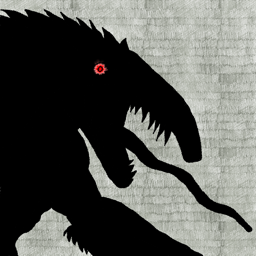
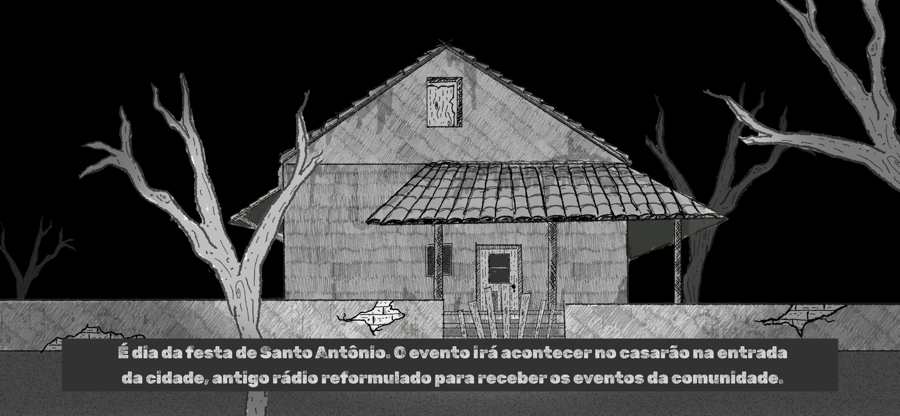
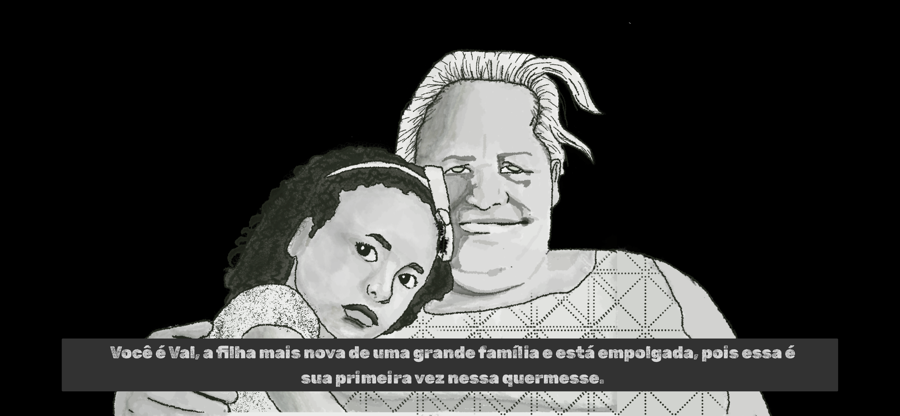
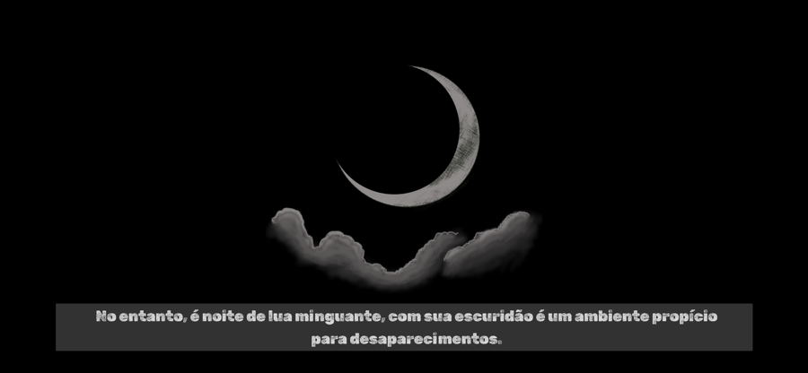
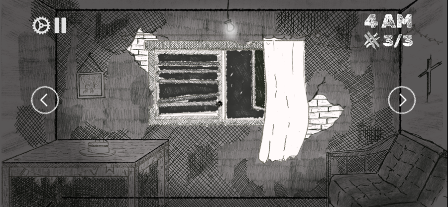

<div align="center">



# Causos Ocultos: Quixeramobim

[](https://developer.apple.com/ios/)
[](https://developer.apple.com/watchos/)
[](https://developer.apple.com/spritekit/)
[](LICENSE.md)

A survival horror game for iPhone and Apple Watch inspired by the folklore of Quixeramobim, in the Brazilian sertão.

<a href="https://apps.apple.com/br/app/causosocultosquixeramobim/id6759735287">
  
</a>

</div>

## Table of Contents

- [About](#about)
- [How to Play](#how-to-play)
- [Screenshots](#screenshots)
- [Built With](#built-with)
- [Getting Started](#getting-started)
- [Project Structure](#project-structure)
- [Team](#team)
- [License](#license)

## About

*O Grito do Sertão: A Noite do Capelobo.* You are Val, the youngest of a big family,
at her first Santo Antônio festival, who ignores grandma's "haunted" tales and stays out late. Then a howl
that does not belong to this world breaks the silence. The Capelobo, a creature from
northern Brazilian folklore, is hunting, and the only goal is to survive until dawn.

Built at the Apple Developer Academy | Mackenzie, with a hand-drawn, cross-hatched
art style. The game is published on the App Store and its text is in Portuguese.

## How to Play

- Move between the rooms of the house: entrance, kitchen, shelf and window.
- Barricade doors and windows before the Capelobo breaks in.
- Find out the creature's story and weak points, then strike back at the right moment.
- Survive each hour of the night until morning comes.
- On the Apple Watch, turn the Digital Crown to switch between rooms and use the
  watch to lure the Capelobo away.

## Screenshots

| Story | Story |
| :---: | :---: |
|  |  |
| **Nightfall** | **Gameplay** |
|  |  |

## Built With

- SpriteKit scenes for the intro, tutorial and every room of the house
- SwiftUI for menus, the HUD and navigation
- WatchConnectivity to sync the iPhone game with the watchOS companion app
- AVFoundation for the soundtrack and sound cues
- Digital Crown input and haptics on Apple Watch

## Getting Started

Requirements: Xcode 26 or later. Run on an iPhone simulator or device with iOS 26.2;
the Apple Watch companion needs a paired watch simulator or device.

```bash
git clone https://github.com/EnzoFerroni/CausosOcultos.git
cd CausosOcultos
open CausosOcultosQuixeramobim.xcodeproj
```

## Project Structure

```
CausosOcultosQuixeramobim/
├── Scenes/
│   ├── FillerScenes/    Intro, tutorial, victory and defeat scenes
│   └── GameScenes/      Rooms of the house and their close-ups
├── Entities/            Player, Enemy, Barricade, Breach
├── Managers/            GameController, SceneManager, SoundManager, iPhone connectivity
├── View/                SwiftUI menu, game, intro and game over views
└── Models/              Enums, fonts
CausosOcultosQuixeramobimW Watch App/   watchOS companion (camera view, crown input)
```

## Team

| Name | GitHub |
| --- | --- |
| Carolina Sun | [@carolssun](https://github.com/carolssun) |
| Dayô Araújo | [@dayoleal](https://github.com/dayoleal) |
| Enzo Ferroni | [@EnzoFerroni](https://github.com/EnzoFerroni) |
| Francisco Losada | [@LosadaT](https://github.com/LosadaT) |
| Isabela Hissa Pinto | [@hissapinto](https://github.com/hissapinto) |
| Jonas Melo | [@JonasFNMelo](https://github.com/JonasFNMelo) |
| Tamires Mendes | [@TamiresMendesS](https://github.com/TamiresMendesS) |
| Yasmin Mendes | [@YasminMSouza](https://github.com/YasminMSouza) |

Fork of the team repository [C11G3/CausosOcultosQuixeramobim](https://github.com/C11G3/CausosOcultosQuixeramobim).

## License

Released under [Creative Commons Attribution-NonCommercial 4.0](LICENSE.md), as chosen
by the team: you may share and adapt the work with credit, but not for commercial use.
